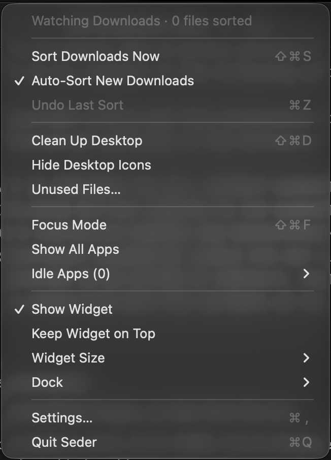
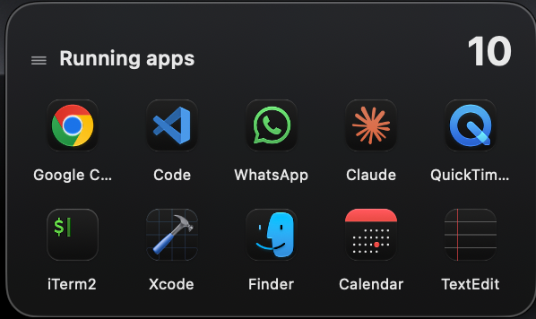
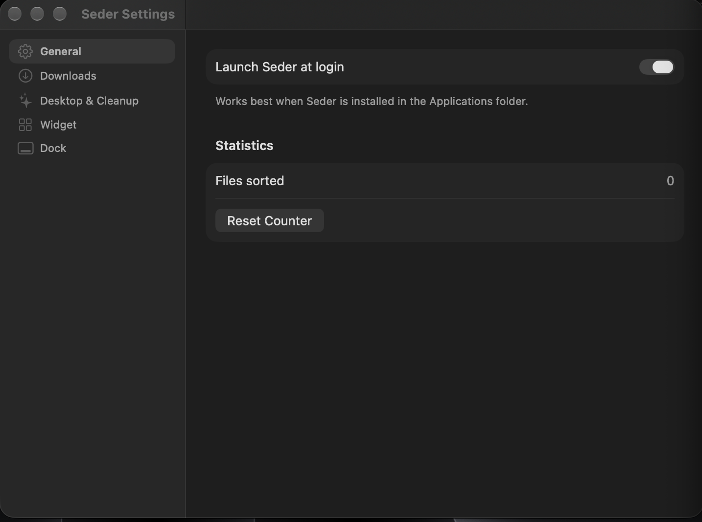

# Seder

**A tiny macOS menu bar app that keeps your Mac tidy.**
Seder ("order" in Hebrew) sorts your Downloads automatically, cleans up your Desktop, shows your running apps in a floating widget, and helps you focus by hiding or quitting apps you're not using.



## Features

### Downloads sorter
- Sorts files in `~/Downloads` into folders by type: **Images, Documents, Videos, Audio, Installers, Archives, Code, Other**
- **Auto-sort:** new downloads are sorted a few seconds after they finish
- Skips unfinished downloads (`.crdownload`, `.part`, …), folders and hidden files
- Never overwrites: duplicates become `file (1).pdf`
- **Undo Last Sort** puts everything back

### Running-apps widget
- A glass widget that sits on your desktop like a native widget
- Shows every open app with its real icon, updated live
- Click to switch to an app; hover ✕ to quit; right-click → Force Quit
- Drag anywhere, 4 sizes, optional "always on top"; position is remembered



### Desktop & cleanup
- **Clean Up Desktop:** sorts Desktop files into the same category folders
- **Hide Desktop Icons:** one switch for a completely clean desktop
- **Unused Files:** lists files in Downloads and on the Desktop you haven't opened in 7–90 days, so you can move them to the Trash

### Focus & Dock
- **Focus Mode:** hides every app except the one you're using
- **Idle Apps:** lists apps you haven't used in a while, with one-click quit
- **Dock settings:** show only open apps, hide recent apps, auto-hide, with an automatic backup and **Restore Original Dock**

### Settings
- One Settings window for everything, plus **Launch at login**



## Safety first

- Seder **never deletes files permanently**. Unused files go to the **Trash**.
- Every sort can be undone.
- Your original Dock settings are backed up before the first change.
- No network access, no analytics. Everything stays on your Mac.

## Requirements

- macOS 15 or later (Apple silicon)
- Xcode 27 to build from source

## Install (build from source)

```bash
git clone https://github.com/RobertTonikyan/Seder.git
cd Seder
xcodebuild -scheme Seder -configuration Release -derivedDataPath build clean build
cp -R build/Build/Products/Release/Seder.app /Applications/
open /Applications/Seder.app
```

If the build complains about signing, open `Seder.xcodeproj` in Xcode, select the **Seder** target → **Signing & Capabilities**, and choose your own Apple ID under **Team**.

### Permissions

On first use macOS will ask to let Seder access your **Downloads** and **Desktop** folders. Click **Allow**. That's needed to move files.

Seder runs without the App Sandbox, because it needs to move files in your folders and change Finder/Dock settings. It's meant for personal use and is not distributed through the App Store.

## How it works

| Part | File |
|---|---|
| Menu bar app & windows | `SederApp.swift`, `MenuContentView.swift` |
| Shared state | `AppState.swift` |
| File categories | `FileCategory.swift` |
| Sorting & undo | `DownloadsSorter.swift` |
| Watching for new downloads | `DownloadsWatcher.swift` |
| Widget window & view | `WidgetController.swift`, `WidgetView.swift`, `WindowDragHandle.swift` |
| Running apps list | `RunningAppsModel.swift` |
| Unused files | `UnusedFilesModel.swift`, `UnusedFilesView.swift` |
| Focus Mode & idle apps | `FocusManager.swift` |
| Finder & Dock settings | `FinderSettings.swift`, `DockSettings.swift` |
| Launch at login | `LoginItem.swift` |
| Settings window | `SettingsView.swift` |

Built with **Swift** and **SwiftUI**, plus AppKit where needed (`NSPanel`, `NSWorkspace`, `ServiceManagement`).

## Roadmap

- [ ] Edit categories and file extensions in Settings
- [ ] Notifications when files are sorted
- [ ] Custom rules (e.g. move files from a specific site to a specific folder)

## Contributing

Issues and pull requests are welcome.

## License

[MIT](LICENSE) © 2026 Robert Tonikyan

## Author

**Robert Tonikyan**: Software Engineering student at Afeka
[GitHub](https://github.com/RobertTonikyan) · [LinkedIn](https://www.linkedin.com/in/robert-tonikian-0b154a227/) · [Portfolio](https://robert-tonikyan.netlify.app)